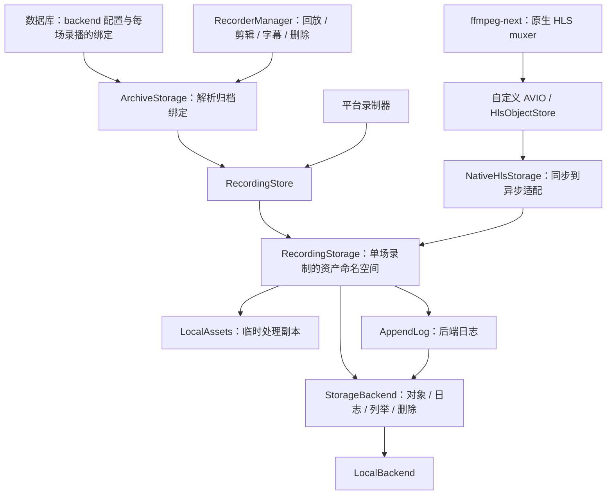

# 录制存储中间层

`recording_storage` 是录制资产的持久化边界。**每场录播独立绑定存储 backend，backend 配置保存在数据库中。** 媒体、播放列表、续录状态、封面、事件/广告日志、字幕，以及归档读取、列举、删除，都通过该场录播绑定的 backend。内置实现是 `LocalBackend`，也可以注入自定义对象后端。

**尚未提供 S3/OSS SDK。** 设置页的“录制存储 → 管理”弹窗支持新增、移除本地后端、选择默认后端和转移已有录播；房间设置只指定后续新录播的存储偏好，不决定历史归档的归属。剪辑、转写等需要本地文件的工具使用显式临时工作区，不把归档当成本地目录。素材及后续文件继续使用原 `output` 流程。

## 依赖与职责



- `RecordingStore`：录制入口注入的服务，负责创建房间或录制命名空间。
- `RecordingStorage`：相对资产 key 的读写、状态查询和媒体发布。
- `StorageBackend`：完整对象读写边界，不要求实现文件句柄、seek、append 或目录。
- `LocalAssets`：从后端按所需对象物化的临时副本，持有租约直到处理结束；不是持久资产或第二个权威副本。
- `AppendLog`：串行化后端日志追加。默认实现基于普通对象读写，不要求 S3/OSS 的原生 append/seek。
- `LocalWorkspace`：保留给旧路径接口的显式适配器。正常录制资产操作不走它；本地修复和日志优化已收进 `LocalBackend`，不再由 session 判断后端类型并绕过 backend。

媒体是否可播放、如何修复 TS、如何判断广告和生成 HLS 播放列表，仍属于 recorder。中间层不依赖 recorder 的平台、媒体或事件类型。

## 实际入口

平台录制器的存储参数接受 `impl Into<RecordingStore>`：

- 原来的 `PathBuf` 调用继续有效，自动构造本地服务。
- 新代码可传入共享的 `RecordingStore`。
- `RecordingStore::with_backend(backend, workspace_root)` 可注入对象后端，由服务统一添加平台/房间/录制前缀。`workspace_root` 只供旧路径接口兼容，正常媒体和日志操作不会在那里创建副本。
- `RecorderTrait::recording_storage(live_id).await` 通过应用注入的 `RecordingResolver` 解析本场录制的存储句柄；独立使用库时也可直接传固定 `RecordingStore`。
- `cache_dir()` / `work_dir()` 暂时保留作为库的旧路径兼容入口；应用层归档流程已使用存储解析或物化，不依赖它们拼接持久路径。

### 数据库配置与每场录播的归属

存储设置通过应用设置页管理；数据库是 backend 定义和默认选择的唯一持久化来源。已发布版本的 `cache` 配置会一次性导入为本地 backend；新安装也可用 `[storage]` TOML 配置引导首次初始化，两者都不是运行时配置来源。保存设置必须提交读取时的 `expected` 快照，配置已被其他客户端修改时拒绝覆盖。

- 旧配置导入会保留原本地目录，不搬移历史录制。导入完成后，重启不会用残留 TOML 覆盖数据库，更不会重新创建已移除的 backend。
- 每个 `RecorderRow.storage_backend_id` 只保存**新录播的选择偏好**；`null` 表示使用数据库中的默认 backend。这一字段不用于解析历史录播。
- 新的一场录制开始时确定 backend；同一场录播的续录沿用原绑定。修改默认值或房间偏好不会将已绑定录播重定向到另一个 backend。
- 应用的 `RecordingResolver` 先把 `(platform, room_id, live_id) → storage_id` 持久化，再交给 recorder 本场的存储句柄。固定 store 的 `prepare()` 也可通过 `RecordingInitializer` 确认绑定。绑定失败会阻止启动，不能只依赖异步 `RecordStart` 事件最终落库。
- recorder 使用本场绑定的 backend 写入；RecorderManager 可以独立按归档绑定解析 backend，读取播放列表、分片、弹幕等，不要求对应 recorder 正在运行。
- 旧归档没有绑定时保留旧默认存储的兼容解析，不跟随后来修改的应用默认值。已绑定归档始终使用记录的 ID；找不到后端是错误，不回退到其他位置。
- backend ID 及其对象命名空间不能被悄悄重新指定。本地目录变化应使用新 ID，再通过显式转移搬迁已有录播；已移除的 ID 仍然保留，不允许重新添加，不能用转移功能恢复已移除的 backend。
- 后续 S3/OSS 适配器可通过 `ArchiveStorage::register_backend(id, store)` 注入。当前没有云存储配置 UI；归档绑定只记录 backend ID，不存储凭证。

### 移除 backend 与不可用录播

移除 backend 是**移除配置**，不是删除录播文件或数据库记录。录播的原 backend ID 和绑定仍然保留。

- 录播列表继续展示标题、时间等数据库信息，并标记该 backend 不可用。
- 预览、剪辑、弹幕导出、字幕生成等需要访问文件的入口不可用；直接请求文件接口同样会失败，不能仅靠前端禁用按钮。
- 可用状态表示配置是否可解析，不表示磁盘、网络或远端服务通过了实时健康检查。
- 默认 backend 不能直接移除，须先选择另一个默认值。移除正在录制使用的 backend 会被拒绝；历史归档引用本身不阻止移除。
- 文件删除失败时仍保留索引以便重试；不因 backend 缺失而把归档当成空目录成功删除。

### 存储转移

在“设置 → 录制存储 → 管理 → 录播转移”中选择源存储 A 和目标存储 B，先根据数据库记录快速估算所需空间，再确认转移。预览阶段不扫描或校验录播文件，只检查根目录的文件系统身份及可用空间，展示预计转移方式。当前支持两个**已配置的本地 backend** 之间转移，来源与目标目录须已存在；不支持已移除的 backend 或尚未实现的远端适配器。

| 预计方式 | 执行方式 | 额外空间 |
| --- | --- | --- |
| 同文件系统快速移动 | 按场对整个录播目录执行不覆盖目标的 `rename`，不读取或复制媒体内容 | 不需要完整录播副本空间，仍需要文件系统可完成目录及转移状态写入 |
| 跨文件系统复制 | 完整复制并校验后更新绑定，再清理来源 | 预览和执行都只按数据库大小估算，实际空间不足由逐场写入报告 |
| 混合 | 新录播可快速移动，但部分未完成任务仍按原复制模式恢复 | 只为需要复制的录播估算副本空间 |

“同文件系统”不等同于“同一硬盘”：不同分区或挂载边界可能无法直接移动。根目录的判断是预判，单场目录实际移动遇到明确的跨文件系统错误（Unix 的 `EXDEV` 或 Windows 对应错误）时，才允许回退到复制，并按该场 DB 大小估算所需空间；权限错误、已有目标等错误不会触发复制回退。

未完成复制的重试仍按数据库中的完整大小估算，不为容量预检查读取已有副本。因此，已有副本可能使实际剩余需求低于估算：只要新增录播的估算空间足够，界面允许尝试恢复，并在预计空间不足时明确提示；执行到该场时才验证和复用已有副本，不要求再次预留完整清单大小的空间。待清理或收尾记录不计入新增复制空间，也不提前计入清理可释放的空间。

转移作为后台任务运行，按录播依次执行，不修改应用默认值或房间的后续录制偏好。两种方式都先持久化转移状态，并与该录播的读写和删除操作互斥。

列表计算录播时间、封面和预览请求会短暂持有读句柄，这些读取不阻止空间预估和只读规划。真正处理每场录播前，转移任务排队等待已有读取结束（最多 30 秒），避免列表刷新不断抢占而导致手动重试。超时会明确报告正在等待的录播，不开始该场的移动、复制或新转移日志写入；此前已完成的录播不会回滚。正在录制、字幕发布或删除等写操作仍是阻塞项。

**快速移动：**持久化来源目录身份及移动意图 → 不覆盖目标地移动目录 → 提交数据库绑定 → 完成收尾。移动目录已经消除原来源路径，不再对该路径进行递归删除，也不对媒体做完整哈希扫描。若移动完成而 DB 提交失败，保留可恢复状态，不把 DB 仍指向 A 误认为文件还在 A；对同一 A → B 重试以完成恢复。

**复制模式：**

1. 后台任务的容量判断仍使用数据库记录大小，不为详细空间统计预先扫描整批录播，也不按完整文件清单大小追加容量限制。新复制使用目标文件系统的可用空间与 DB 估算值比较；重试允许复用已有副本。估算可能低于实际大小，实际写入遇到空间不足则停止当前录播，保留来源与恢复状态。
2. 将单场录播的完整资产复制到目标，包含分片、播放列表、封面、字幕、日志及内部日志块和检查点。
3. 完整复制并校验后，在数据库中将该场录播从 A 改绑到 B。普通录制启动仍不能覆盖已有绑定，只有显式转移可以切换。
4. 数据库切换成功后，清理 A 中该场录播的文件，然后处理下一场。

容量估算放宽不代表省略复制校验：当前录播仍会建立用于恢复的文件清单并校验内容，只有完整副本验证成功后才切换绑定。复制错误、空间不足或后续录播失败不会回滚已经完成的录播，也不会删除尚未成功切换的来源文件。

| 失败阶段 | 录播归属 | 处理 |
| --- | --- | --- |
| 检查空间或状态 | A | 不开始复制，解决问题后重新检查 |
| 复制模式的复制或数据库切换 | A | 保留源文件，不把不完整目标作为可用录播 |
| 快速移动后、数据库切换前 | DB 仍为 A，文件已在 B | 明确报告待恢复状态，保留目录身份与转移记录；重试同一 A → B，不覆盖或误删目标 |
| 切换后的源清理 | B | 保留可用目标，报告待清理源文件；对同一 A → B 重试 |
| 后续录播失败 | 已完成的在 B，其余在 A | 不回滚已完成的录播，任务报告部分完成情况 |

转移方式与阶段持久化到数据库，重试会识别未完成的移动、复制和待清理记录，不盲目覆盖目标同名目录。已经回退到复制的任务保持复制语义，不因为现在两个根目录在同文件系统就重新解释为移动。相同 backend、实际指向相同位置的目录、互相包含的源/目标目录，以及根目录或录播路径祖先中的符号链接都不能用于转移。快速移动把目录内部内容整体移走，不遍历或跟随内部符号链接；复制模式继续拒绝内部符号链接和特殊文件。

关闭设置弹窗不会取消后台任务；进度可在任务中心查看。转移暂不提供取消按钮，异常退出后可重新检查同一对存储并重试。只处理录播数据库索引对应的资产命名空间，不搬迁房间公共封面、无索引的其他文件、系统临时目录或 `output` 素材。

### 系统临时目录

没有临时目录设置。应用启动时通过 `tempfile` 在系统临时目录创建一个私有、随机命名的会话目录；`State`、HTTP 服务和处理任务持有它的租约，最后一个租约释放时清理。

- 单文件上传、批量上传和上传导入均在会话目录下暂存；整个请求成功后才发布临时文件。请求失败或取消清理部分文件；成功文件保留到会话结束，不承诺重启后继续上传。
- 预览音频和项目处理缓存放在会话目录，可丢弃并重新生成。网页导出下载暂存也使用这里；用户明确指定的导出目标和素材 `output` 路径不变。
- `/cache/uploads`、`/cache/preview_audio`、`/cache/exports` 保留为兼容资源 URL，但只解析当前会话的临时文件；`/cache/{platform}/...` 仍解析录制 backend。URL 中的 `cache` 不代表旧全局目录配置仍在使用。
- 正常退出清理自有目录；强制终止后的残留交由系统临时目录策略处理。不扫描删除其他实例或旧缓存目录中的文件。

```rust
use recorder::recording_storage::RecordingStore;

let store = RecordingStore::local(cache_root);
let recording = store.recording("bilibili", "123", "1700000000000")?;
recording.prepare().await?;

// 完整对象写入：适用于封面、小型状态快照及播放列表。
recording.write("cover.jpg", &cover_bytes).await?;
recording.write(".sequence", b"42").await?;

let sequence = recording.read(".sequence").await?;
let cover_size = recording.size("cover.jpg").await?;
```

本地布局保持为：

```text
cache/
└── bilibili/
    └── 123/
        ├── cover.jpg                 # 房间封面
        └── 1700000000000/
            ├── playlist.m3u8
            ├── .sequence
            ├── segment-42.ts
            ├── cover.jpg
            ├── events.jsonl
            └── skipped_ad_ranges.jsonl
```

`scope("bilibili/123")` 用于房间封面等非单场录制资产。`recording(platform, room_id, live_id)` 分别校验身份组件；资产 key 使用相对的 UTF-8 名称，不允许以 `..` 等形式越出命名空间。本地根目录是可信配置，不是针对其他本地进程的文件系统沙箱。

## 媒体与原生 FFmpeg 边界

录制媒体不再通过本地路径交给 FFmpeg。三条链路分别是：

1. **FLV/RTMP 输出**：`record_to_hls_objects` 使用原生 HLS muxer 的 `io_open` / `io_close2` 和自定义 AVIO。分片关闭时先将完整字节提交给 backend；随后才允许发布引用它的播放列表。续录读取的是 backend 中的播放列表，不是工作区副本。
2. **HLS 探测**：下载完成后通过 backend 保存分片，再读出字节，交给 `extract_video_metadata_from_bytes`；fMP4 使用 `extract_video_metadata_from_parts(init, media)` 的可 seek 字节输入。
3. **RTMP 封面**：从 backend 读取首个分片，调用 `extract_jpeg_from_bytes`，最后将 JPEG 字节写回 backend。

```rust
// HLS 下载和探测：FFmpeg 不需要知道资产存放在哪个文件或 bucket。
recording.write("segment-42.ts", &segment_bytes).await?;
let metadata = ffmpeg_utils::extract_video_metadata_from_bytes(
    recording.read("segment-42.ts").await?,
).await?;

// 确认媒体可用之后，才更新播放器可见的引用。
recording.write("playlist.m3u8", &playlist_bytes).await?;
```

`ffmpeg_utils` 不依赖 recorder 或 `recording_storage`，只定义同步的对象接口：

```rust
pub trait HlsObjectStore: Send + Sync {
    fn read(&self, key: &str, cancelled: &AtomicBool) -> io::Result<Vec<u8>>;
    fn write(&self, key: &str, bytes: &[u8], cancelled: &AtomicBool) -> io::Result<()>;
}
```

recorder 的 `NativeHlsStorage` 在 FFmpeg 阻塞工作线程中，通过捕获的 Tokio runtime handle 等待异步 backend 操作。每次提交完成才继续 mux，从而形成背压；不为一整场直播建立无限上传队列。取消信号会中断等待中的 backend future，FFI 回调中的错误由原生适配器记住并返回，不能因 FFmpeg 忽略某些 close 返回值而误报成功。

自定义输出按完整对象暂存字节，默认每个对象上限为 64 MiB；超过上限会返回错误，不会静默截断。FFmpeg HLS 内部还暂存一个 TS，因此另有保守的压缩包预算（payload/extra data 的四倍加每包 4 KiB）；极高码率或超长 GOP 可能在输出达到 64 MiB 前被拒绝。清单也受限，因此单个 EVENT 归档不能无限增长。

`StorageBackend` 增加必需的 `read_bounded(key, max_bytes)`，要求在读取过程中限制内存，而不是完整分配后才检查长度；原生续录和进度查询都使用它。字节探测只允许录制媒体容器，禁止将 HLS 等嵌套清单当成字节媒体再访问外部文件或网络。所有调用仍使用 **FFmpeg 库（`ffmpeg-next`）**，没有 CLI 依赖。

测试使用内存 backend 完成原生录制、续录和媒体探测，并断言本地输出目录未创建；RTMP 推流测试还覆盖使用独立 backend 生成封面。

`RecordingStorage::append_media` 始终委托给 backend，表达“将前一分片替换为合并后的完整对象”：`LocalBackend` 使用流式临时文件替换，默认对象实现读取两段并写回完整对象，提交后再清理原片段。这不是原生远端 append，也不是跨对象事务。

## 日志和兼容读取

```rust
let events = recording.open_log("events.jsonl").await?;
events.append(b"{\"type\":\"example\"}\n").await?;
events.flush().await?;
```

业务侧序列化完整记录。每次成功的 `append` 已提交到所选 backend，不把未提交数据留到 `flush` 或 Drop；`flush` 等待同一日志句柄的在途追加。取消调用者时，在途追加仍持有串行锁完成，下一次追加不能与它交错。recorder 停止/重置时还会通过服务级 `flush_logs` 等待这些在途提交，避免日志在归档删除之后重新出现。

默认对象日志保留原来的 JSONL 基础对象，在私有 `.recording-logs/...` 命名空间写入最多 64 KiB 的块，最后更新八字节已提交块计数。每批追加需要一次元数据 GET、若干块 PUT 和一次元数据 PUT；不会每条弹幕重写整场日志。`read_log` 合并旧基础对象及已提交块；损坏计数、缺失已提交块和后端故障都会报错。未提交块由归档删除一并清理。

`LocalBackend` 可以优化为普通文件 append + sync，仍保持旧 JSONL 布局。两种格式都由同一 `read_log` 读取；应用层使用只读的 `DanmuStorage::read_entries`，读取弹幕不会创建或打开可写日志。日志要求单写者；不承诺网络确认丢失时的 exactly-once。

recorder 增加了存储句柄入口，同时保留路径包装接口：

| 调用方 | 新接口 | 兼容入口 |
| --- | --- | --- |
| 弹幕/事件 | `DanmuStorage::from_storage(&storage, key)` | `DanmuStorage::new(&Path)`，也接受 `&PathBuf` |
| 广告范围 | `load_skipped_ad_ranges_from_storage` / `append_skipped_ad_range_to_storage` | 原来的 `&Path` 函数 |
| 历史 entries | `EntryStore::from_storage(&storage)` | `EntryStore::new(work_dir)` |
| HLS/FLV 构造 | 传 `RecordingStorage` | 仍可传 `PathBuf` |

现有 `events.jsonl`、旧 `danmu.txt`、`entries.log` 的解析规则不变。兼容路径包装要求文件名可表示为 UTF-8；本地父目录不受此限制。

## 应用层入口

- `RecorderManager::recording_storage` 根据归档绑定解析后端；播放列表、弹幕、时间轴、字幕和 HLS 对象均从这里读取。
- GUI 与 headless `/cache` 共用存储感知的 HTTP handler，支持 HEAD、单 Range、206/416 和有界分块响应。已识别的录制路径不会回退到临时目录；内部日志块/元数据不公开。非录制请求只允许上述三个会话命名空间。
- 剪辑按范围选择媒体与继承的 init/key 依赖，再创建 `LocalAssets`；保留原播放列表时间轴。物化用有界 Range 复制，避免整段大文件一次性分配。字幕只在生成成功后提交最终 `subtitle.srt`，中途失败不会清空旧字幕。
- 删除先验证完整归档身份及录制状态，再删除所选后端资产，最后移除数据库索引和绑定。字幕发布与删除共用进程内归档修改锁，冲突时拒绝操作，避免后处理在删除后重建资产。删除房间会收集历史/当前后端，避免只清理最新后端；失败保留索引以便重试。跨后端删除不是事务。
- 录制写入租约也持有归档修改锁，覆盖准备阶段和尚未完成的日志写入，不只依赖 UI 上的“正在录制”状态。删除完成后留下录播 ID 的删除标记，阻止延迟的续录请求重新绑定同一 ID；后续新录播使用新 ID。
- 历史 entries/封面迁移通过后端操作；每条历史记录使用自己的平台身份，不借用同 ID 新 recorder 的平台。

## 一致性边界

- 完整对象替换与日志追加分开；序号快照不再通过 recorder 持有文件并执行 seek。
- 不把读取失败一概解释成不存在；`exists` 只将 `NotFound` 转换为 `false`。
- HLS 按媒体对象写入、字节探测、播放列表更新的顺序工作；FLV/RTMP 在自定义 AVIO 关闭完整分片后提交，分片提交失败不能继续发布引用它的播放列表。
- 本地 TS 追加修复保持当前行为；这不代表已经解决远端同名对象或 CDN 缓存失效问题。
- FFmpeg 的 AVIO、字节缓冲和取消守卫由原生 worker 持有；失败或取消时不能从析构路径发布未完成对象。
- 自定义 AVIO 的资源由适配器回收；正常初始化后的异常退出会以丢弃输出的方式结束 muxer。FFmpeg 9 在 HLS 部分初始化失败时仍有私有动态缓冲释放限制，此处没有通过访问私有 ABI 或强行调用 trailer 来规避。
- 没有跨媒体、播放列表和 checkpoint 的原子事务。崩溃恢复和远端幂等发布需要后续单独设计。
- 已提供完整读取、有界读取、Range、分页枚举和可重试清理；远端对象版本、并发写入控制及跨对象恢复仍需后续设计。

## 如何查看与验证接口

从仓库根目录运行：

```sh
cargo test --manifest-path src-tauri/Cargo.toml -p recording_storage --locked
cargo run --manifest-path src-tauri/Cargo.toml -p recording_storage --example local_recording --locked
cargo test --manifest-path src-tauri/Cargo.toml -p recorder --locked
cargo test --manifest-path src-tauri/Cargo.toml -p ffmpeg_utils --locked --lib hls::
cargo test --manifest-path src-tauri/Cargo.toml --no-default-features --features headless --locked
```

`local_recording` 示例使用临时目录，不会写入用户实际录制缓存。它展示资产命名空间、媒体发布、checkpoint、播放列表和事件日志的基本调用，程序退出后清理示例目录。

下一步可以实现具体 S3/OSS adapter，并补真实服务上的鉴权、重试、对象版本和成本验证；不需要让平台 recorder 或归档消费者重新拼接本地路径。
