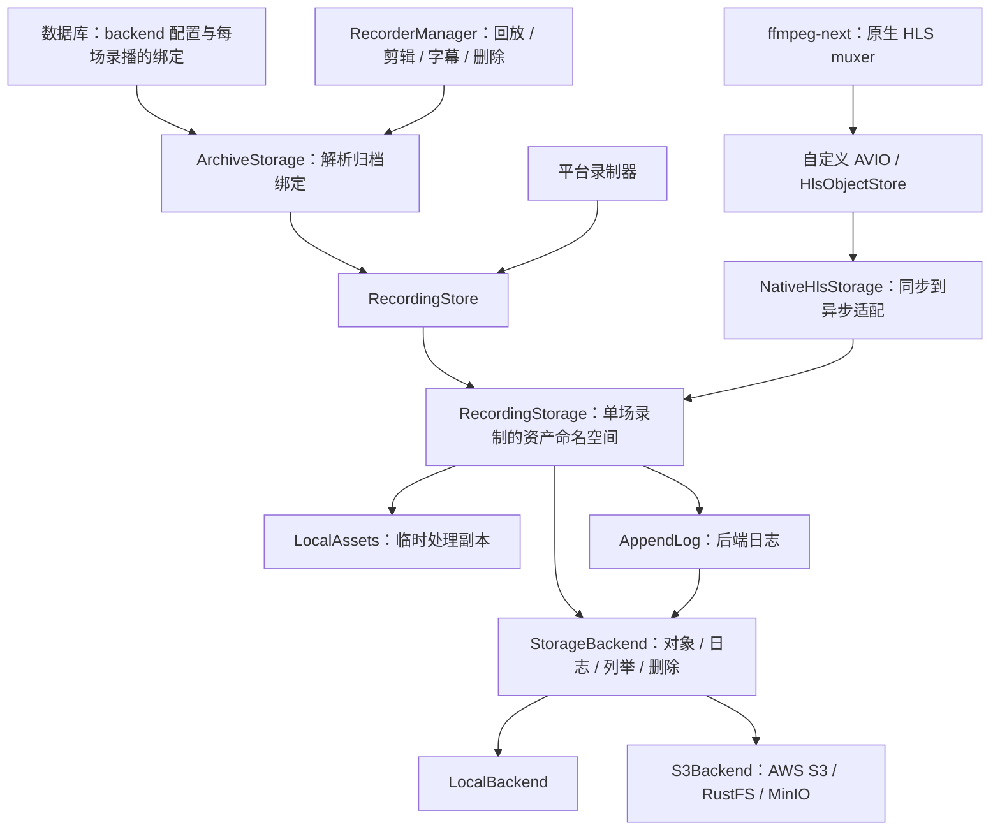

# 录制存储中间层

每个本地/S3 存储使用独立的 JSON 录播目录；主 SQLite 提供可重建的列表索引。启动迁移、单写者限制、挂载/卸载及目录转移协议见 [JSON 录播目录](./recording-catalog.md)。

`recording_storage` 是录制资产的持久化边界。**每场录播独立绑定存储 backend，backend 配置保存在数据库中。** 媒体、播放列表、续录状态、封面、事件/广告日志、字幕，以及归档读取、列举、删除，都通过该场录播绑定的 backend。内置实现是 `LocalBackend` 和兼容 AWS S3 / RustFS / MinIO 的 `S3Backend`，也可以注入自定义对象后端。

设置页的“录制存储 → 管理”弹窗支持新增、移除本地及 S3 后端、选择默认后端，以及本地 ↔ 本地、S3 ↔ 本地、S3 ↔ S3 的录播转移；房间设置只指定后续新录播的存储偏好，不决定历史归档的归属。剪辑、转写等需要本地文件的工具使用显式临时工作区，不把归档当成本地目录。素材及后续文件继续使用原 `output` 流程。

## 依赖与职责



- `RecordingStore`：录制入口注入的服务，负责创建房间或录制命名空间。
- `RecordingStorage`：相对资产 key 的读写、状态查询和媒体发布。
- `StorageBackend`：完整对象读写边界，不要求实现文件句柄、seek、append 或目录。
- `LocalAssets`：从后端按所需对象物化的临时副本，持有租约直到处理结束；不是持久资产或第二个权威副本。
- `AppendLog`：串行化后端日志追加。默认实现基于普通对象读写，不要求 S3/OSS 的原生 append/seek。
- `LocalWorkspace`：保留给旧路径接口的显式适配器。正常录制资产操作不走它；本地修复和日志优化已收进 `LocalBackend`，不再由 session 判断后端类型并绕过 backend。

媒体是否可播放、如何修复 TS、如何判断广告和生成 HLS 播放列表，仍属于 recorder。中间层不依赖 recorder 的平台、媒体或事件类型。

## 实际入口

平台录制器的存储参数接受 `impl Into<RecordingStore>`：

- 原来的 `PathBuf` 调用继续有效，自动构造本地服务。
- 新代码可传入共享的 `RecordingStore`。
- `RecordingStore::with_backend(backend, workspace_root)` 可注入对象后端，由服务统一添加平台/房间/录制前缀。`workspace_root` 只供旧路径接口兼容，正常媒体和日志操作不会在那里创建副本。
- `RecorderTrait::recording_storage(live_id).await` 通过应用注入的 `RecordingResolver` 解析本场录制的存储句柄；独立使用库时也可直接传固定 `RecordingStore`。
- `cache_dir()` / `work_dir()` 暂时保留作为库的旧路径兼容入口；应用层归档流程已使用存储解析或物化，不依赖它们拼接持久路径。

### 数据库配置与每场录播的归属

存储设置通过应用设置页管理；数据库是 backend 定义和默认选择的唯一持久化来源。已发布版本的 `cache` 配置会一次性导入为本地 backend；新安装也可用 `[storage]` TOML 配置引导首次初始化，两者都不是运行时配置来源。保存设置必须提交读取时的 `expected` 快照，配置已被其他客户端修改时拒绝覆盖。

- 旧配置导入会保留原本地目录，不搬移历史录制。导入完成后，重启不会用残留 TOML 覆盖数据库，更不会重新创建已移除的 backend。
- 每个 `RecorderRow.storage_backend_id` 只保存**新录播的选择偏好**；`null` 表示使用数据库中的默认 backend。这一字段不用于解析历史录播。
- 新的一场录制开始时确定 backend；同一场录播的续录沿用原绑定。修改默认值或房间偏好不会将已绑定录播重定向到另一个 backend。
- 应用的 `RecordingResolver` 先把 `(platform, room_id, live_id) → storage_id` 持久化，再交给 recorder 本场的存储句柄。固定 store 的 `prepare()` 也可通过 `RecordingInitializer` 确认绑定。绑定失败会阻止启动，不能只依赖异步 `RecordStart` 事件最终落库。
- recorder 使用本场绑定的 backend 写入；RecorderManager 可以独立按归档绑定解析 backend，读取播放列表、分片、弹幕等，不要求对应 recorder 正在运行。
- 旧归档没有绑定时保留旧默认存储的兼容解析，不跟随后来修改的应用默认值。已绑定归档始终使用记录的 ID；找不到后端是错误，不回退到其他位置。
- 挂载中的 backend ID 及其对象命名空间不能被悄悄重新指定。卸载后名称可复用，房间偏好仍绑定原存储 UUID；重新挂载原存储会恢复其录播目录。旧数据未迁移或转移未完成时不能卸载有记录的存储。
- S3 后端通过设置页配置；其他适配器仍可通过 `ArchiveStorage::register_backend(id, store)` 注入。归档绑定只记录 backend ID，不存储凭证。

### S3 兼容存储

在“设置 → 录制存储 → 管理 → 添加存储”选择 **S3 兼容对象存储**：

| 配置 | 说明 |
| --- | --- |
| Endpoint | 填写服务 origin，例如 OSS 的 `https://s3.oss-cn-shanghai.aliyuncs.com`；AWS 可留空，RustFS 可填 `http://127.0.0.1:9000`。不能带路径、用户名、密码或查询参数 |
| Bucket | 预先创建的通用 S3 bucket；应用不自动创建 bucket，不支持 S3 Express |
| Region | AWS 使用实际区域；本地 RustFS 使用 `us-east-1` |
| 对象前缀 | 可选，例如 `shadowreplay`，不带首尾 `/`；其下仍按 `平台/房间/场次/资产` 组织 |
| Path-style | 开启时请求 `endpoint/bucket/key`；关闭时请求 `bucket.endpoint/key`，自定义 endpoint 必须是 DNS 域名而非 IP。兼容已包含 `bucket.` 的域名，不重复添加；不支持不带 bucket 前缀的桶专属 CNAME |
| Access Key ID | 直接在设置表单中填写 |
| Secret Access Key | 直接在设置表单中填写，密码输入框，不回显已保存的值 |
| Session Token | 可选，仅临时凭证需要填写 |

**应用只使用设置中保存的凭证，不读取环境变量、AWS profile 或实例角色。** 每个后端独立保存一组凭证。已有后端可点击“更新凭证”，填写完整的 Access Key ID / Secret Access Key；Session Token 留空会清除原令牌。保存后新建客户端立即使用新凭证，无需重启应用；正在录制的后端需先停止录制再更新。不自动刷新临时凭证。

凭证通过单独的写入参数提交，不进入通用配置 DTO、TOML、存储位置标识或 API 响应；普通默认值修改保留已保存凭证。配置快照只包含随机的凭证版本号，防止另一客户端用旧快照覆盖已更新的凭证。移除后端也移除其凭证记录，不删除录播文件。

凭证存储复用账号的 `CredentialCipher`：默认启用 `credential-encryption` 时使用系统钥匙串中的密钥进行 AES-256-GCM 加密。**关闭该 feature 的构建（例如部分 headless 构建）与账号凭证一样以明文保存到数据库**，应限制数据库、备份和 Docker volume 的访问权限。已加密的存储凭证不能被无加密构建当作明文读取；密钥丢失或不可解密时明确报错，不自动生成新密钥覆盖。远程访问应用设置时必须使用 HTTPS 保护提交的凭证。

保存配置后会尝试打开存储目录，设置显示连接、只读或错误状态；连接失败保留配置供修复重试，不回退到本地目录。生产环境使用 HTTPS。需要 bucket 列举权限，以及所配置前缀内的对象读取（含 HEAD）、写入和删除权限；无需开放 bucket 的公共读取或浏览器 CORS，浏览器通过应用现有 HTTP 接口访问资产。

后端 ID 的 endpoint、bucket、前缀及其他配置保存后不可变；更换位置应使用新 ID，不允许把旧归档悄悄指向新 bucket。S3 录制、回放、Range 读取、日志续写、物化剪辑输入和删除都沿用同一存储层，不保留本地完整副本。远端日志使用 `.recording-logs` 分块格式；读取/写入以单个对象为单位，原子替换不代表跨对象事务。单次 PUT 限制为服务端支持的对象大小（AWS 为 5 GiB），当前不提供 multipart 上传；录制分片应保持在该限制以内。

#### 用 RustFS 本地验证

仓库提供独立的 `docker_compose.rustfs.yaml`，仅绑定本机 `9000`（API）和 `9001`（控制台）。测试数据保留在 Docker named volume，`down` 不删除数据。以下命令在仓库根目录的 Bash 中运行：

```bash
# 交互输入，不将密钥写入仓库或 shell 历史。
read -rp 'RustFS access key: ' RUSTFS_ACCESS_KEY
read -rsp 'RustFS secret key: ' RUSTFS_SECRET_KEY; echo
export RUSTFS_ACCESS_KEY RUSTFS_SECRET_KEY
docker compose -f docker_compose.rustfs.yaml up -d
curl --fail http://127.0.0.1:9000/health
```

在 `http://127.0.0.1:9001/rustfs/console/` 使用上述凭证登录，创建私有 bucket `recordings`。可通过 `RUSTFS_IMAGE` 指定已验证的 RustFS 镜像 tag/digest；默认使用官方 `latest`，测试报告应记录实际镜像版本。然后直接在应用设置中填写相同的 Access Key ID 和 Secret Access Key，Session Token 留空；无需给应用设置环境变量。

以下环境变量**只供自动化测试程序传入测试凭证**，不是应用的配置方式：

```bash
export S3_TEST_ACCESS_KEY_ID="$RUSTFS_ACCESS_KEY"
export S3_TEST_SECRET_ACCESS_KEY="$RUSTFS_SECRET_KEY"
export S3_TEST_ENDPOINT=http://127.0.0.1:9000
export S3_TEST_BUCKET=recordings
cargo test --manifest-path src-tauri/Cargo.toml -p recording_storage \
  --test s3_rustfs --locked -- --ignored --nocapture
```

该显式 opt-in 测试会在独立随机前缀下验证对象替换、特殊字符 key、分页、Range/EOF、限长读取、日志重开、临时物化和隔离删除；成功后清空该前缀。失败时可能保留对象，输出会给出测试前缀，确认后可在 RustFS 控制台清理。缺少环境变量或服务不可达会失败，不会悄悄跳过。普通 `cargo test -p recording_storage` 不依赖 Docker，包含本地 HTTP 模拟服务的 S3 协议测试，但不能替代真实服务验证。

启动应用，添加 endpoint 为 `http://127.0.0.1:9000`、bucket 为 `recordings`、region 为 `us-east-1`、path-style 开启的后端，并在表单中填写凭证。选择它作为默认值或房间的下一场录制偏好，检查新录制、停止后回放、剪辑、重启后读取及删除。已有录播仍留在原后端，可使用“录播转移”显式搬迁。

设置上述 `S3_TEST_*` 后，还可运行真实转移测试。测试使用独立前缀，覆盖本地 → S3 → S3 → 本地及反向路径、凭据持久化、日志和附属文件完整性、来源清理，以及条件 PUT 拒绝覆盖：

```bash
cargo test --manifest-path src-tauri/Cargo.toml --no-default-features \
  --features headless --bin bili-shadowreplay rustfs_storage_transfer_all_directions \
  --locked -- --ignored --nocapture
```

若应用本身也在容器内，`127.0.0.1` 指向应用容器，而非 RustFS；应使用同一 Docker 网络上的 RustFS 服务名作为 endpoint。完成测试后可运行 `docker compose -f docker_compose.rustfs.yaml down` 停止服务并保留数据。

### 移除 backend 与不可用录播

移除 backend 是**卸载存储**，不删除该存储上的媒体和 JSON 录播目录。

- 已卸载存储的录播从列表和统计隐藏，重新添加同一路径或 S3 bucket/prefix 后恢复。
- 离线但仍挂载的存储保留最近一次索引及错误状态；不能把连接失败当作空目录。
- 已有其他目录写入者时允许只读播放，不允许修改资产。需要修改时先释放原写入者，再重新加载存储设置。
- 默认 backend 不能直接移除，须先选择另一个默认值。正在录制、处理任务、待提交结束事件、未完成转移或未完成迁移会阻止卸载。
- 文件删除失败时仍保留索引以便重试；不因 backend 缺失而把归档当成空目录成功删除。

### 存储转移

在“设置 → 录制存储 → 管理 → 录播转移”中选择源存储 A 和目标存储 B，先根据数据库记录快速估算所需空间，再确认转移。预览阶段不扫描或校验录播对象；本地端检查根目录身份及可用空间，S3 端解析配置和凭证，实际网络访问由逐场执行验证。支持已配置的本地和 S3 后端任意方向转移；本地根目录、S3 bucket 须已存在。S3 目标的 `available_bytes` 为 `null`，界面显示容量未知，不将未知当作零或“空间足够”。

| 预计方式 | 执行方式 | 额外空间 |
| --- | --- | --- |
| 同文件系统快速移动 | 按场对整个录播目录执行不覆盖目标的 `rename`，不读取或复制媒体内容 | 不需要完整录播副本空间，仍需要文件系统可完成目录及转移状态写入 |
| 跨文件系统复制 | 完整复制并校验后更新绑定，再清理来源 | 预览和执行都只按数据库大小估算，实际空间不足由逐场写入报告 |
| 混合 | 新录播可快速移动，但部分未完成任务仍按原复制模式恢复 | 只为需要复制的录播估算副本空间 |
| 对象复制（任一端为 S3） | 逐对象复制及 SHA-256 校验，切换绑定后清理来源 | 目标需容纳完整资产；系统临时目录额外暂存单个对象，S3 剩余容量不可预估 |

“同文件系统”不等同于“同一硬盘”：不同分区或挂载边界可能无法直接移动。根目录的判断是预判，单场目录实际移动遇到明确的跨文件系统错误（Unix 的 `EXDEV` 或 Windows 对应错误）时，才允许回退到复制，并按该场 DB 大小估算所需空间；权限错误、已有目标等错误不会触发复制回退。

未完成复制的重试仍按数据库中的完整大小估算，不为容量预检查读取已有副本。因此，已有副本可能使实际剩余需求低于估算：只要新增录播的估算空间足够，界面允许尝试恢复，并在预计空间不足时明确提示；执行到该场时才验证和复用已有副本，不要求再次预留完整清单大小的空间。待清理或收尾记录不计入新增复制空间，也不提前计入清理可释放的空间。

转移作为后台任务运行，按录播依次执行，不修改应用默认值或房间的后续录制偏好。两种方式都先持久化转移状态，并与该录播的读写和删除操作互斥。

列表计算录播时间、封面和预览请求会短暂持有读句柄，这些读取不阻止空间预估和只读规划。真正处理每场录播前，转移任务排队等待已有读取结束（最多 30 秒），避免列表刷新不断抢占而导致手动重试。超时会明确报告正在等待的录播，不开始该场的移动、复制或新转移日志写入；此前已完成的录播不会回滚。正在录制、字幕发布或删除等写操作仍是阻塞项。

**快速移动：**持久化来源目录身份及移动意图 → 不覆盖目标地移动目录 → 目标目录接收元数据、来源目录退役 → 提交数据库绑定 → 完成收尾。移动目录已经消除原来源路径，不再对该路径进行递归删除，也不对媒体做完整哈希扫描。若移动完成而目录/DB 提交失败，保留可恢复状态；对同一 A → B 重试以完成恢复。

**复制模式：**

1. 后台任务的容量判断仍使用数据库记录大小，不为详细空间统计预先扫描整批录播，也不按完整文件清单大小追加容量限制。新复制使用目标文件系统的可用空间与 DB 估算值比较；重试允许复用已有副本。估算可能低于实际大小，实际写入遇到空间不足则停止当前录播，保留来源与恢复状态。
2. 将单场录播的完整资产复制到目标，包含分片、播放列表、封面、字幕、日志及内部日志块和检查点。
3. 完整复制并校验后，在数据库中将该场录播从 A 改绑到 B。普通录制启动仍不能覆盖已有绑定，只有显式转移可以切换。
4. 数据库切换成功后，清理 A 中该场录播的文件，然后处理下一场。

容量估算放宽不代表省略复制校验：当前录播仍会建立用于恢复的文件清单并校验内容，只有完整副本验证成功后才切换绑定。复制错误、空间不足或后续录播失败不会回滚已经完成的录播，也不会删除尚未成功切换的来源文件。

| 失败阶段 | 录播归属 | 处理 |
| --- | --- | --- |
| 检查空间或状态 | A | 不开始复制，解决问题后重新检查 |
| 复制模式的复制或数据库切换 | A | 保留源文件，不把不完整目标作为可用录播 |
| 快速移动后、数据库切换前 | DB 仍为 A，文件已在 B | 明确报告待恢复状态，保留目录身份与转移记录；重试同一 A → B，不覆盖或误删目标 |
| 切换后的源清理 | B | 保留可用目标，报告待清理源文件；对同一 A → B 重试 |
| 后续录播失败 | 已完成的在 B，其余在 A | 不回滚已完成的录播，任务报告部分完成情况 |

转移方式与阶段持久化到数据库，重试会识别未完成的移动、复制和待清理记录，不盲目覆盖目标同名目录。已经回退到复制的任务保持复制语义，不因为现在两个根目录在同文件系统就重新解释为移动。相同 backend、实际指向相同位置的目录、互相包含的源/目标目录，以及根目录或录播路径祖先中的符号链接都不能用于转移。快速移动把目录内部内容整体移走，不遍历或跟随内部符号链接；复制模式继续拒绝内部符号链接和特殊文件。

关闭设置弹窗不会取消后台任务；进度可在任务中心查看。转移暂不提供取消按钮，异常退出后可重新检查同一对存储并重试。只处理录播数据库索引对应的资产命名空间，不搬迁房间公共封面、无索引的其他文件、系统临时目录或 `output` 素材。

#### 涉及 S3 的对象复制

对象转移沿用同一套录播写锁、读取屏障以及 `copying → cleanup → finalizing` 数据库阶段，单独记录 `object` 模式；升级不会重新解释已有本地转移日志。

- S3 ↔ S3 通过应用所在机器中转，可跨 endpoint、bucket 和凭证，不依赖供应商的服务端复制 API。单次只暂存一个对象到系统临时目录，网络和文件 I/O 使用流式传输，内存不随对象大小增长。目标为本地时仍需完整目标空间；临时目录若与目标同分区，还需额外留出一个对象的中转空间。
- 逐场建立包含路径、长度、SHA-256 和来源版本的清单，包含媒体、字幕、封面、检查点和 `.recording-logs` 私有日志。S3 不表示空目录；对象转移不保留空目录，清理本地来源后可能留下空目录。
- 先持久化 DB 日志，再以原子“不覆盖”方式创建目标命名空间内的 `.recording-transfer.json` 凭据。目标已有对象但没有匹配凭据时拒绝转移，即使内容相同也不接管。请勿手工编辑清单或删除未完成转移的凭据。
- 重试复用已校验对象；本地采用原子不覆盖发布，S3 在单实例写入和应用转移锁约束下先检查目标不存在，再使用普通 PUT，不要求条件写入。已存在但内容不符的对象会报错，不能以“重试”为由覆盖。S3 使用单次流式 PUT，单对象最多 5 GiB，不支持 multipart；禁止其他实例或工具同时修改目标。
- 本地目标的对象与凭据先写入存储根目录的 `.recording-transfer-object-*` 私有临时目录，再通过同文件系统原子不覆盖重命名发布；临时字节不进入 `platform/room/live` 文件清单。正常返回会清理临时目录，崩溃遗留的根目录暂存文件不会阻塞清单校验，但可能占用空间，暂不自动回收。不会忽略或自动删除录播目录中已有的未知 `.tmp*` 文件；不支持所需原子重命名的文件系统会报错而不是退化为覆盖。
- 完整目标校验成功后才切换数据库绑定；来源清理前重新验证目标及所有剩余来源对象。清理中断可继续，但不会忽略未知新增对象或来源修改。`finalizing` 重试只收尾凭据和日志，不会再次清理重新出现的来源数据。
- 同一 endpoint / bucket 下相同或互相包含的前缀不能用于转移。不同 endpoint 别名是否指向同一服务无法可靠推断，应由配置者保证命名空间独立。凭证可访问的录播命名空间必须由应用独占管理，转移期间停止其他工具或实例的写入；S3 不提供跨对象事务，校验后删除也不能防御外部并发修改。

### 本机磁盘信息

总览中的“本机磁盘”是独立的主机信息，与默认录制 backend 无关。`get_disk_info` 返回存储池数组，每项包含标识 `id`、显示名 `name`、挂载点列表 `mount_points`、总字节数 `total` 和可用字节数 `free`；桌面和 HTTP 接口格式一致。使用 S3 时仍可查看运行应用的机器上的磁盘，而不是浏览器所在机器或 S3 bucket 的容量。容器部署只能看到容器可见的挂载点。

macOS 通过 `diskutil info -plist` 的 APFS 容器标识合并共享空间的卷（包括系统快照和 Data 卷），容量使用容器本身的总量和空闲空间，不累加卷容量或使用量。名称取挂载点排序后的首个卷名称，因此系统盘优先显示 `Macintosh HD`；名称只用于展示，不是判重依据。探测有超时与并发限制；无法识别、数据不完整及非 APFS 文件系统按挂载点保留。Windows/Linux 暂无共享存储池探测，仍保留独立文件系统条目，不按容量、卷名或物理硬盘猜测合并。悬浮名称可查看对应挂载点。

磁盘加载失败不影响其他总览数据。“录播总大小”继续使用数据库中的录播资产大小统计，包含不同 backend 的录播，不代表本机磁盘占用。剪辑、导出前的空间检查仍查询实际输出或工作目录所在的文件系统，不使用存储池列表代替。

磁盘区宽屏两列、窄屏单列，只展示名称、占用进度、可用和总容量，不显示常驻说明或独立刷新按钮。数据继续跟随录播变更、页面恢复可见和定时同步自动更新，读取失败后也由后续自动同步恢复。

### 系统临时目录

没有临时目录设置。应用启动时通过 `tempfile` 在系统临时目录创建一个私有、随机命名的会话目录；`State`、HTTP 服务和处理任务持有它的租约，最后一个租约释放时清理。

- 单文件上传、批量上传和上传导入均在会话目录下暂存；整个请求成功后才发布临时文件。请求失败或取消清理部分文件；成功文件保留到会话结束，不承诺重启后继续上传。
- 预览音频和项目处理缓存放在会话目录，可丢弃并重新生成。网页导出下载暂存也使用这里；用户明确指定的导出目标和素材 `output` 路径不变。
- `/cache/uploads`、`/cache/preview_audio`、`/cache/exports` 保留为兼容资源 URL，但只解析当前会话的临时文件；`/cache/{platform}/...` 仍解析录制 backend。URL 中的 `cache` 不代表旧全局目录配置仍在使用。
- 正常退出清理自有目录；强制终止后的残留交由系统临时目录策略处理。不扫描删除其他实例或旧缓存目录中的文件。

```rust
use recorder::recording_storage::RecordingStore;

let store = RecordingStore::local(cache_root);
let recording = store.recording("bilibili", "123", "1700000000000")?;
recording.prepare().await?;

// 完整对象写入：适用于封面、小型状态快照及播放列表。
recording.write("cover.jpg", &cover_bytes).await?;
recording.write(".sequence", b"42").await?;

let sequence = recording.read(".sequence").await?;
let cover_size = recording.size("cover.jpg").await?;
```

本地布局保持为：

```text
cache/
└── bilibili/
    └── 123/
        ├── cover.jpg                 # 房间封面
        └── 1700000000000/
            ├── playlist.m3u8
            ├── .sequence
            ├── segment-42.ts
            ├── cover.jpg
            ├── events.jsonl
            └── skipped_ad_ranges.jsonl
```

`scope("bilibili/123")` 用于房间封面等非单场录制资产。`recording(platform, room_id, live_id)` 分别校验身份组件；资产 key 使用相对的 UTF-8 名称，不允许以 `..` 等形式越出命名空间。本地根目录是可信配置，不是针对其他本地进程的文件系统沙箱。

## 媒体与原生 FFmpeg 边界

录制媒体不再通过本地路径交给 FFmpeg。三条链路分别是：

1. **FLV/RTMP 输出**：`record_to_hls_objects` 使用原生 HLS muxer 的 `io_open` / `io_close2` 和自定义 AVIO。分片关闭时先将完整字节提交给 backend；随后才允许发布引用它的播放列表。续录读取的是 backend 中的播放列表，不是工作区副本。
2. **HLS 探测**：下载完成后通过 backend 保存分片，再读出字节，交给 `extract_video_metadata_from_bytes`；fMP4 使用 `extract_video_metadata_from_parts(init, media)` 的可 seek 字节输入。
3. **RTMP 封面**：从 backend 读取首个分片，调用 `extract_jpeg_from_bytes`，最后将 JPEG 字节写回 backend。

```rust
// HLS 下载和探测：FFmpeg 不需要知道资产存放在哪个文件或 bucket。
recording.write("segment-42.ts", &segment_bytes).await?;
let metadata = ffmpeg_utils::extract_video_metadata_from_bytes(
    recording.read("segment-42.ts").await?,
).await?;

// 确认媒体可用之后，才更新播放器可见的引用。
recording.write("playlist.m3u8", &playlist_bytes).await?;
```

`ffmpeg_utils` 不依赖 recorder 或 `recording_storage`，只定义同步的对象接口：

```rust
pub trait HlsObjectStore: Send + Sync {
    fn read(&self, key: &str, cancelled: &AtomicBool) -> io::Result<Vec<u8>>;
    fn write(&self, key: &str, bytes: &[u8], cancelled: &AtomicBool) -> io::Result<()>;
}
```

recorder 的 `NativeHlsStorage` 在 FFmpeg 阻塞工作线程中，通过捕获的 Tokio runtime handle 等待异步 backend 操作。每次提交完成才继续 mux，从而形成背压；不为一整场直播建立无限上传队列。取消信号会中断等待中的 backend future，FFI 回调中的错误由原生适配器记住并返回，不能因 FFmpeg 忽略某些 close 返回值而误报成功。

自定义输出按完整对象暂存字节，默认每个对象上限为 64 MiB；超过上限会返回错误，不会静默截断。FFmpeg HLS 内部还暂存一个 TS，因此另有保守的压缩包预算（payload/extra data 的四倍加每包 4 KiB）；极高码率或超长 GOP 可能在输出达到 64 MiB 前被拒绝。清单也受限，因此单个 EVENT 归档不能无限增长。

`StorageBackend` 增加必需的 `read_bounded(key, max_bytes)`，要求在读取过程中限制内存，而不是完整分配后才检查长度；原生续录和进度查询都使用它。字节探测只允许录制媒体容器，禁止将 HLS 等嵌套清单当成字节媒体再访问外部文件或网络。所有调用仍使用 **FFmpeg 库（`ffmpeg-next`）**，没有 CLI 依赖。

测试使用内存 backend 完成原生录制、续录和媒体探测，并断言本地输出目录未创建；RTMP 推流测试还覆盖使用独立 backend 生成封面。

`RecordingStorage::append_media` 始终委托给 backend，表达“将前一分片替换为合并后的完整对象”：`LocalBackend` 使用流式临时文件替换，默认对象实现读取两段并写回完整对象，提交后再清理原片段。这不是原生远端 append，也不是跨对象事务。

## 日志和兼容读取

```rust
let events = recording.open_log("events.jsonl").await?;
events.append(b"{\"type\":\"example\"}\n").await?;
events.flush().await?;
```

业务侧序列化完整记录。每次成功的 `append` 已提交到所选 backend，不把未提交数据留到 `flush` 或 Drop；`flush` 等待同一日志句柄的在途追加。取消调用者时，在途追加仍持有串行锁完成，下一次追加不能与它交错。recorder 停止/重置时还会通过服务级 `flush_logs` 等待这些在途提交，避免日志在归档删除之后重新出现。

默认对象日志保留原来的 JSONL 基础对象，在私有 `.recording-logs/...` 命名空间写入最多 64 KiB 的块，最后更新八字节已提交块计数。每批追加需要一次元数据 GET、若干块 PUT 和一次元数据 PUT；不会每条弹幕重写整场日志。`read_log` 合并旧基础对象及已提交块；损坏计数、缺失已提交块和后端故障都会报错。未提交块由归档删除一并清理。

`LocalBackend` 可以优化为普通文件 append + sync，仍保持旧 JSONL 布局。两种格式都由同一 `read_log` 读取；应用层使用只读的 `DanmuStorage::read_entries`，读取弹幕不会创建或打开可写日志。日志要求单写者；不承诺网络确认丢失时的 exactly-once。

录制启动和续录只使用 `DanmuWriter::from_storage` 打开追加位置，不调用
`read_log`、下载历史分块或建立历史事件缓存。远端已有日志只读取八字节提交计数，
不随历史事件数量增加启动请求数；计数损坏仍报错，不清零、不覆盖历史。
已有基础对象和分块保持原样，预览/回放/导出需要历史内容时再独立读取。

实时事件在 `DanmuWriter` 中批量提交，本地与 S3 使用同一触发规则：

- 当前批次第一条事件接收后 **5 秒**，或序列化后的 JSONL（含换行）
  累计达到 **64 KiB / 65,536 字节**，先到者触发提交。后续事件不重置计时，
  无事件时不发送空批次。
- 单条事件保持完整；超大事件交给底层日志拆成不超过 64 KiB 的块，
  仍由一次提交计数更新发布。既有日志格式、历史读取和转移规则不变，不做 compact。
- 预览先发送实时事件，不等批量提交。独立上传任务的等待队列最多 128 条事件；
  上传持续变慢或失败时队列满会产生背压，不无限累积内存。
- 上传失败保留当前批次及其最初的追加位置，每 5 秒重试；期间不消耗更多队列事件。
  如果远端提交计数已前移，核对本批次内容后确认成功，不从新位置重复追加；
  核对本身失败也保留原位置。未提交的块仍使用原序号重写。本地文件核对已写前缀，
  只补写缺失部分。位置或内容冲突时拒绝追加；这依赖同一日志只有一个写入者，
  不是跨实例的 exactly-once 协议。
- 停止、切换/重置录播会关闭队列，提交剩余事件并等待完成。关闭等待被取消时，
  存储服务仍跟踪后台任务，归档删除前的 `flush_logs` 会等待它结束。
  关闭时提交仍失败则返回并记录错误，不留下持续重试、可能重建已删除对象的任务。
- `add_event` 成功表示进入内存队列，不代表已经落盘。此版本不引入本地恢复日志：
  强制退出/断电可能丢失待提交事件；正常网络下窗口约为 5 秒加上传耗时，
  网络故障时可能更长。历史查询只返回已提交事件。

底层 `AppendLog` 及离线兼容接口 `DanmuStorage` 仍保持成功返回即完成提交的语义。
旧的逐事件分块不会自动合并，读取这些历史仍可能需要较多请求。

预览窗口不等待历史弹幕或发送账号请求完成，就建立弹幕层和实时订阅。
历史请求失败只显示可重试提示，不影响视频与实时弹幕；迟到的历史结果会合并
期间收到的实时事件，不覆盖它们，也不重复显示重叠记录。窗口关闭后忽略迟到结果。
对象日志按一次读取的提交计数并发获取历史块（最多 8 个），仍按提交顺序拼接，
缺失或损坏的已提交块会令整次读取失败，不返回不完整的历史。

recorder 增加了存储句柄入口，同时保留路径包装接口：

| 调用方 | 新接口 | 兼容入口 |
| --- | --- | --- |
| 录制中的事件追加 | `DanmuWriter::from_storage(&storage, key)` | 不加载历史 |
| 显式历史缓存兼容接口 | `DanmuStorage::from_storage(&storage, key)` | `DanmuStorage::new(&Path)`，也接受 `&PathBuf`；不用于录制启动 |
| 广告范围 | `load_skipped_ad_ranges_from_storage` / `append_skipped_ad_range_to_storage` | 原来的 `&Path` 函数 |
| 历史 entries | `EntryStore::from_storage(&storage)` | `EntryStore::new(work_dir)` |
| HLS/FLV 构造 | 传 `RecordingStorage` | 仍可传 `PathBuf` |

现有 `events.jsonl`、旧 `danmu.txt`、`entries.log` 的解析规则不变。兼容路径包装要求文件名可表示为 UTF-8；本地父目录不受此限制。

### 录制恢复耗时日志

每次启动/续录生成一个新的 `attempt` ID，即使续录沿用同一个 `live_id` 也能区分。
日志包含平台、房间、录播 ID 和阶段，不增加直播 URL、Cookie 或弹幕内容输出。

- `Recording preparation started`：仅表示开始准备，代替原先容易误解的
  `New record started`。
- `Startup stage started/completed/failed/cancelled`：阶段开始，以及结果；
  结果带该阶段 `duration_ms` 与本次尝试累计 `total_ms`。
- 准备阶段包括 `stream_open`、`storage_resolve`、`storage_prepare`、
  `cover_prepare`、`danmu_append_open`、`record_start_dispatch`。
- HLS 进一步记录 `.sequence` 读取、广告范围加载、播放列表恢复/重新打开、
  fMP4 初始化及上一分片探测。播放列表恢复后记录原序号和已有分片数。
- 应用的 `RecordStart received` 仅表示生命周期事件到达，不表示已写入视频。
- `First new media committed`：本次尝试首个新媒体及引用它的播放列表已成功
  发布，`startup_ms` 才是到该持久化里程碑的耗时。HLS 覆盖正常分片和修复
  追加；FLV/RTMP 必须先写入新媒体，再发布引用它的播放列表。重读旧播放列表、
  仅写入媒体、跳过坏片或发布失败不会触发此日志。
- `media_pull` 阶段持续到本次录制结束，其完成耗时是整个拉流阶段时长，
  不是首片恢复耗时。历史弹幕读取另有 DEBUG 起止日志和失败耗时，不混入准备阶段。
- 提前换流日志包含 `expires_at_unix` 和 `remaining_seconds`，避免把提前
  刷新误认为 CDN 已经断流。换流提前量及重试策略不变。
- 上一次录制清理另有 `Recording cleanup` 和 `Event log drain` 日志，
  可区分等待在途弹幕写入完成与下一次启动准备的耗时。

回归测试：

```sh
cargo test --manifest-path src-tauri/Cargo.toml -p recorder --lib writer_tests --locked
cargo test --manifest-path src-tauri/Cargo.toml -p recorder --lib startup --locked
cargo test --manifest-path src-tauri/Cargo.toml -p recorder --lib --locked
```

其中使用永久阻塞历史读取的后端验证 10,000 个历史分块不会阻止视频发起播放列表
请求；同时覆盖续写不改旧内容、坏计数拒绝打开和首片发布日志的时机。
批量写入测试使用可控时钟验证 5 秒、64 KiB 两种触发条件，覆盖空闲不写入、
超大 UTF-8 事件、失败重试、队列背压、关闭/取消及停止和续录时的尾批次提交。
`python3 scripts/test-json-catalog-rustfs.py` 还会在独立 RustFS 容器中检查
100 条小事件只产生一个数据对象，以及续录、大小触发、尾批次和读取的兼容性；
测试使用临时凭证，不访问应用配置的存储。

## 应用层入口

- `RecorderManager::recording_storage` 根据归档绑定解析后端；播放列表、弹幕、时间轴、字幕和 HLS 对象均从这里读取。
- GUI 与 headless `/cache` 共用存储感知的 HTTP handler，支持 HEAD、单 Range、206/416 和有界分块响应。已识别的录制路径不会回退到临时目录；内部日志块/元数据不公开。非录制请求只允许上述三个会话命名空间。
- 剪辑按范围选择媒体与继承的 init/key 依赖，再创建 `LocalAssets`；保留原播放列表时间轴。物化用有界 Range 复制，避免整段大文件一次性分配。字幕只在生成成功后提交最终 `subtitle.srt`，中途失败不会清空旧字幕。
- 删除先验证完整归档身份及录制状态，再删除所选后端资产，最后移除数据库索引和绑定。字幕发布与删除共用进程内归档修改锁，冲突时拒绝操作，避免后处理在删除后重建资产。删除房间会收集历史/当前后端，避免只清理最新后端；失败保留索引以便重试。跨后端删除不是事务。
- 录制写入租约也持有归档修改锁，覆盖准备阶段和尚未完成的日志写入，不只依赖 UI 上的“正在录制”状态。删除完成后留下录播 ID 的删除标记，阻止延迟的续录请求重新绑定同一 ID；后续新录播使用新 ID。
- 历史 entries/封面迁移通过后端操作；每条历史记录使用自己的平台身份，不借用同 ID 新 recorder 的平台。

## 一致性边界

- 完整对象替换与日志追加分开；序号快照不再通过 recorder 持有文件并执行 seek。
- 不把读取失败一概解释成不存在；`exists` 只将 `NotFound` 转换为 `false`。
- HLS 按媒体对象写入、字节探测、播放列表更新的顺序工作；FLV/RTMP 在自定义 AVIO 关闭完整分片后提交，分片提交失败不能继续发布引用它的播放列表。
- 本地 TS 追加修复保持当前行为；这不代表已经解决远端同名对象或 CDN 缓存失效问题。
- FFmpeg 的 AVIO、字节缓冲和取消守卫由原生 worker 持有；失败或取消时不能从析构路径发布未完成对象。
- 自定义 AVIO 的资源由适配器回收；正常初始化后的异常退出会以丢弃输出的方式结束 muxer。FFmpeg 9 在 HLS 部分初始化失败时仍有私有动态缓冲释放限制，此处没有通过访问私有 ABI 或强行调用 trailer 来规避。
- 没有跨媒体、播放列表和 checkpoint 的原子事务。崩溃恢复和远端幂等发布需要后续单独设计。
- 已提供完整读取、有界读取、Range、分页枚举和可重试清理；远端对象版本、并发写入控制及跨对象恢复仍需后续设计。

## 如何查看与验证接口

从仓库根目录运行：

```sh
cargo test --manifest-path src-tauri/Cargo.toml -p recording_storage --locked
cargo run --manifest-path src-tauri/Cargo.toml -p recording_storage --example local_recording --locked
cargo test --manifest-path src-tauri/Cargo.toml -p recorder --locked
cargo test --manifest-path src-tauri/Cargo.toml -p ffmpeg_utils --locked --lib hls::
cargo test --manifest-path src-tauri/Cargo.toml --no-default-features --features headless --locked
```

`local_recording` 示例使用临时目录，不会写入用户实际录制缓存。它展示资产命名空间、媒体发布、checkpoint、播放列表和事件日志的基本调用，程序退出后清理示例目录。

下一步可以实现具体 S3/OSS adapter，并补真实服务上的鉴权、重试、对象版本和成本验证；不需要让平台 recorder 或归档消费者重新拼接本地路径。
