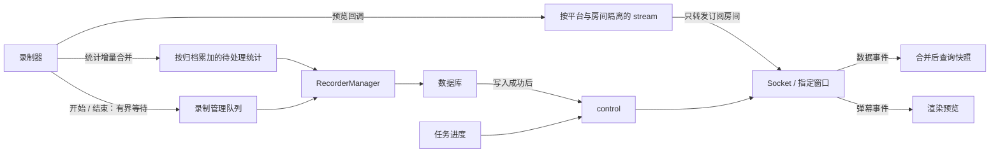

# Tauri Invoker

## 概述

`invoker.ts` 是对 Tauri 命令调用的封装层，位于 `src/lib/invoker.ts`。它提供了类型安全的前后端通信接口，简化了 Tauri 命令的调用。

## 基本用法

### 导入

```typescript
import { invoke } from '@tauri-apps/api/core';
// 或使用封装的 invoker
import { invokeCommand } from '$lib/invoker';
```

### 调用 Tauri 命令

```typescript
// 基本调用
const result = await invoke('command_name', { arg1: value1, arg2: value2 });

// 使用类型安全的封装
const result = await invokeCommand<ReturnType>('command_name', {
  arg1: value1,
  arg2: value2
});
```

## Tauri 命令系统

### 后端命令定义

在 Rust 后端，使用 `#[tauri::command]` 宏定义命令：

```rust
#[tauri::command]
async fn get_rooms(state: State<'_, AppState>) -> Result<Vec<Room>, String> {
    // 实现逻辑
    Ok(rooms)
}

// 在 main.rs 中注册
fn main() {
    tauri::Builder::default()
        .invoke_handler(tauri::generate_handler![
            get_rooms,
            // ... 其他命令
        ])
        .run(tauri::generate_context!())
        .expect("error while running tauri application");
}
```

### 前端调用

```typescript
import { invoke } from '@tauri-apps/api/core';

interface Room {
  id: string;
  name: string;
  platform: string;
  url: string;
}

async function loadRooms(): Promise<Room[]> {
  try {
    const rooms = await invoke<Room[]>('get_rooms');
    return rooms;
  } catch (error) {
    console.error('Failed to load rooms:', error);
    throw error;
  }
}
```

## 常用命令封装

### 录制相关命令

```typescript
// 开始录制
export async function startRecording(roomId: string): Promise<string> {
  return await invoke<string>('start_recording', { roomId });
}

// 停止录制
export async function stopRecording(recordingId: string): Promise<void> {
  await invoke('stop_recording', { recordingId });
}

// 获取录制状态
export async function getRecordingStatus(recordingId: string) {
  return await invoke('get_recording_status', { recordingId });
}
```

### 直播间管理命令

```typescript
// 添加直播间
export async function addRoom(platform: string, url: string) {
  return await invoke('add_room', { platform, url });
}

// 删除直播间
export async function deleteRoom(roomId: string) {
  await invoke('delete_room', { roomId });
}

// 更新直播间配置
export async function updateRoomConfig(roomId: string, config: RoomConfig) {
  await invoke('update_room_config', { roomId, config });
}
```

### 切片相关命令

```typescript
// 生成切片
export async function createClip(
  recordingId: string,
  startTime: number,
  endTime: number
) {
  return await invoke('create_clip', {
    recordingId,
    startTime,
    endTime
  });
}

// 获取切片列表
export async function getClips(recordingId: string) {
  return await invoke('get_clips', { recordingId });
}
```

### 切片任务生命周期

实时回放页使用 `clip_range` 生成切片时会保存当前 `eventId`，监听 `progress-update:<eventId>` 和 `progress-finished:<eventId>` 更新按钮状态。页面卸载不会取消后端切片任务；切片任务进入 `TaskManager` 后会继续在后台运行。若页面关闭/刷新时仍有切片任务运行，前端会通过 `beforeunload` 触发浏览器原生离开确认，并在页面内提示用户可前往任务页面管理后台任务；浏览器不允许自定义原生离开确认文案。只有用户显式触发取消时，才会调用 `cancel` 命令将任务状态写为 `cancelled`，并中止关联的 FFmpeg 处理。切片完成、失败或取消请求返回后，前端会清理进度监听器并恢复生成按钮状态。


## 应用事件系统

后端统一通过 `src-tauri/src/events` 的 `EventBus` 发布应用事件。任务进度、任务完成、弹幕和数据变更使用同一个 `AppEvent` 模型；事件名和 JSON 载荷由 `model.rs` 定义，Tauri 和 Socket.IO 传输层只负责转发，不再各自匹配业务事件。

应用启动时创建一个 `EventBus`，注入 `State`、`Database` 和 `RecorderManager`。数据库写入成功后发布 `DataChanged`；`ProgressReporter` 发布任务进度和完成事件。弹幕在录制器产生事件时，通过预览回调直接进入事件系统，不经过处理数据库操作的录制管理队列；原始弹幕的保存流程独立于预览订阅。

录制管理队列使用容量为 512 的有界 MPSC 通道。开始、结束等生命周期事件在队列满时等待，不覆盖旧事件；接收器在启动监听任务前创建，避免启动订阅空窗。周期性录制统计按归档 ID 合并增量，时长和字节数累加，待处理项按先到先处理轮转；处理 `RecordEnd` / `LiveEnd` 前先写入该归档剩余的统计增量。视频分片下载不因统计队列积压而等待，统计增量也不会直接丢弃。

应用事件内部使用两类缓冲：全局 control 容量为 1024，传递任务通知与数据失效事件；stream 按 `(platform, room)` 隔离，每个正在观看的房间容量为 256。无人观看时不创建房间缓冲或转发预览，最后一个订阅释放后回收缓冲。control 订阅者落后时收到 `state-resync`；某个房间的 stream 落后时只跳过过期预览并记录该房间丢失数量，不触发列表查询，也不挤掉其他房间的预览。

这些容量是有界缓冲预算，不代表“支持多少直播间”或固定时间窗口。单房间预览能吸收的暂停时间约为 `256 / 单房间事件速率`，例如 100 条/秒时约为 2.56 秒；需要结合实际峰值和消费者处理速度调整，没有经过生产负载容量测定。房间缓冲的空间随实际被观看的房间数量增加，而不是随全部录制房间的弹幕总量增加。

前端 `src/lib/events.ts` 统一管理订阅、错误隔离、Socket.IO 重连和事件分发；`invoker.ts` 继续导出 `listen` 作为兼容入口。两端使用相同的客户端事件名：

| 事件名 | 载荷 / 用途 |
| --- | --- |
| `progress-update:<taskId>` | `{ id, content }`，任务进度 |
| `progress-finished:<taskId>` | `{ id, success, message }`，任务完成 |
| `danmu:<platform>:<room 的 UTF-8 十六进制>` | `{ platform, room, ts, type, content, user_name, price, sc_duration }`，房间弹幕和醒目留言；编码支持 `@`、冒号及 Unicode 房间名 |
| `videos-changed` / `tasks-changed` / `recorders-changed` / `records-changed` | `null`，重新查询对应数据 |
| `state-resync` | `null`，重连或 control 事件丢失后的校准 |

Web 端用 Socket.IO 的通用事件入口分发通知，新事件不需要再增加一套前端转发分支；对旧服务端的无任务 ID 后缀进度事件保留归一化兼容。`listen` 能根据已知事件名推断载荷类型，返回的清理函数应在组件卸载时调用。页面的数据查询合并、串行刷新及 30 秒兜底校准由 `state-refresh.ts` 管理。

录播页也订阅 `records-changed` / `recorders-changed`。进行中的时长/体积增量、任务的 processing 进度和直播间标题/封面变化，在写入可查询状态后按事件类型使用固定一秒窗口合并失效通知，持续更新时也不会无限延期。这个窗口在全局 EventBus 上共享，不随直播间/任务数量增加而增加通知频率；开始、结束、任务完成等状态变化仍立即通知，具体任务的进度事件仍实时发送。

弹幕仍使用同一 `listen` 接口，但必须指定平台和房间；调用者不需要拼接底层事件名：

```typescript
const unlisten = await listen("danmu", ({ payload }) => {
  renderDanmu(payload);
}, { platform: "youtube", room: "@EliraPendora" });
// 组件卸载时调用 unlisten()，同时取消弹幕批处理定时器。
```

前端对同一房间的订阅计数：首次订阅添加房间，最后一次清理移除房间。Web 通过 `event-rooms` 将当前房间集合同步给服务端，断线期间不排队旧的订阅请求，重连时重发最新集合；每个 Socket 单独维护转发任务，断开时释放。桌面端通过 `set_event_rooms` 同步当前窗口的房间集合，只向该窗口发送预览，窗口销毁时释放；本地监听先于服务端订阅，命令串行执行，防止迟到的订阅覆盖清理结果。

每个 Socket/窗口的 `event-rooms` / `set_event_rooms` 请求最多包含 32 个预览话题，去重前先检查数量，超限或非法请求不会修改已有订阅或创建新缓冲。这个限制只约束同时观看的预览，不限制添加或录制的直播间数量。Web 使用 ACK 返回 `{ ok: true }` 或 `{ ok: false, error: string }`，`listen` 在 ACK 成功后才完成；拒绝或 5 秒 ACK 超时会撤销本地监听并抛出错误。断线时的首次订阅等待重连后最新集合的 ACK，保持与桌面端错误语义一致。

`listen` 的第四个参数可传 `AbortSignal`。播放器卸载时会取消包括等待重连/ACK 在内的订阅并撤销本地监听，迟到的 ACK 不会恢复已经取消的房间；重连仍只同步当前有效集合。

Socket.IO 的底层发送队列也是有界的。预览发送遇到临时队列满时丢弃该条预览并累计日志，保持订阅继续工作；control 发送遇到队列满时暂停该客户端的预览转发，等待后重试同一事件。预览不占用全部发送能力而导致任务完成通知退出转发循环。该策略保证临时拥堵时的处理优先级，不是断线后的事件持久化或重放；断线仍由重新订阅和快照校准恢复。



### 后端错误返回

Rust 命令应该返回 `Result<T, String>`：

```rust
#[tauri::command]
async fn risky_operation() -> Result<String, String> {
    match perform_operation() {
        Ok(result) => Ok(result),
        Err(e) => Err(format!("Operation failed: {}", e))
    }
}
```

### 前端错误处理

```typescript
async function safeInvoke<T>(command: string, args?: any): Promise<T | null> {
  try {
    return await invoke<T>(command, args);
  } catch (error) {
    console.error(`Command ${command} failed:`, error);
    // 可以在这里添加用户通知
    showNotification('error', `操作失败: ${error}`);
    return null;
  }
}
```

## 事件系统

除了命令调用，Tauri 还支持事件系统用于后端主动推送数据。

### 后端发送事件

```rust
use tauri::Manager;

#[tauri::command]
async fn start_monitoring(app: tauri::AppHandle) {
    tokio::spawn(async move {
        loop {
            // 监控逻辑
            let status = get_status();

            // 发送事件到前端
            app.emit_all("status-update", status).unwrap();

            tokio::time::sleep(Duration::from_secs(1)).await;
        }
    });
}
```

### 前端监听事件

```typescript
import { listen } from '@tauri-apps/api/event';

// 监听事件
const unlisten = await listen('status-update', (event) => {
  console.log('Status update:', event.payload);
  // 更新 UI 或 store
});

// 组件销毁时取消监听
onDestroy(() => {
  unlisten();
});
```

## 类型定义

### 共享类型定义

在 `src/lib/interface.ts` 中定义前后端共享的类型：

```typescript
export interface Room {
  id: string;
  name: string;
  platform: 'bilibili' | 'douyin' | 'douyu' | 'huya' | 'kuaishou' | 'tiktok' | 'twitch' | 'youtube';
  url: string;
  status: 'online' | 'offline';
  config: RoomConfig;
}

export interface RoomConfig {
  autoRecord: boolean;
  quality: 'high' | 'medium' | 'low';
  savePath: string;
}

export interface Recording {
  id: string;
  roomId: string;
  startTime: number;
  endTime?: number;
  status: 'recording' | 'stopped' | 'error';
  filePath: string;
}

export interface Clip {
  id: string;
  recordingId: string;
  startTime: number;
  endTime: number;
  title: string;
  filePath: string;
}
```

### 命令参数类型

```typescript
// 为每个命令定义参数类型
export interface StartRecordingParams {
  roomId: string;
}

export interface CreateClipParams {
  recordingId: string;
  startTime: number;
  endTime: number;
  title?: string;
}

// 使用类型安全的调用
export async function startRecording(params: StartRecordingParams) {
  return await invoke<string>('start_recording', params);
}
```

## 最佳实践

1. **类型安全**: 始终为命令调用和返回值定义类型
2. **错误处理**: 使用 try-catch 包装所有 invoke 调用
3. **加载状态**: 在调用期间显示加载指示器
4. **超时处理**: 对长时间运行的命令设置超时
5. **重试机制**: 对网络相关的命令实现重试逻辑

## 示例：完整的命令封装

```typescript
import { invoke } from '@tauri-apps/api/core';
import { writable } from 'svelte/store';

// 加载状态 store
export const isLoading = writable(false);

// 通用命令调用封装
async function safeInvoke<T>(
  command: string,
  args?: any,
  options?: {
    showLoading?: boolean;
    timeout?: number;
  }
): Promise<T> {
  const { showLoading = true, timeout = 30000 } = options || {};

  if (showLoading) {
    isLoading.set(true);
  }

  try {
    // 创建超时 Promise
    const timeoutPromise = new Promise((_, reject) =>
      setTimeout(() => reject(new Error('Command timeout')), timeout)
    );

    // 执行命令
    const result = await Promise.race([
      invoke<T>(command, args),
      timeoutPromise
    ]);

    return result as T;
  } catch (error) {
    console.error(`Command ${command} failed:`, error);
    throw error;
  } finally {
    if (showLoading) {
      isLoading.set(false);
    }
  }
}

// 使用封装的命令
export async function startRecording(roomId: string) {
  return await safeInvoke<string>('start_recording', { roomId }, {
    showLoading: true,
    timeout: 10000
  });
}
```

## 调试

### 启用 Tauri 调试日志

在开发模式下，Tauri 会输出详细的日志：

```typescript
// 在 tauri.conf.json 中配置
{
  "build": {
    "devPath": "http://localhost:5173",
    "beforeDevCommand": "yarn dev"
  },
  "tauri": {
    "bundle": {
      "active": true
    }
  }
}
```

### 前端调试

```typescript
// 添加调试日志
if (import.meta.env.DEV) {
  const originalInvoke = invoke;
  window.invoke = async (command: string, args?: any) => {
    console.log(`[Invoke] ${command}`, args);
    const result = await originalInvoke(command, args);
    console.log(`[Result] ${command}`, result);
    return result;
  };
}
```
