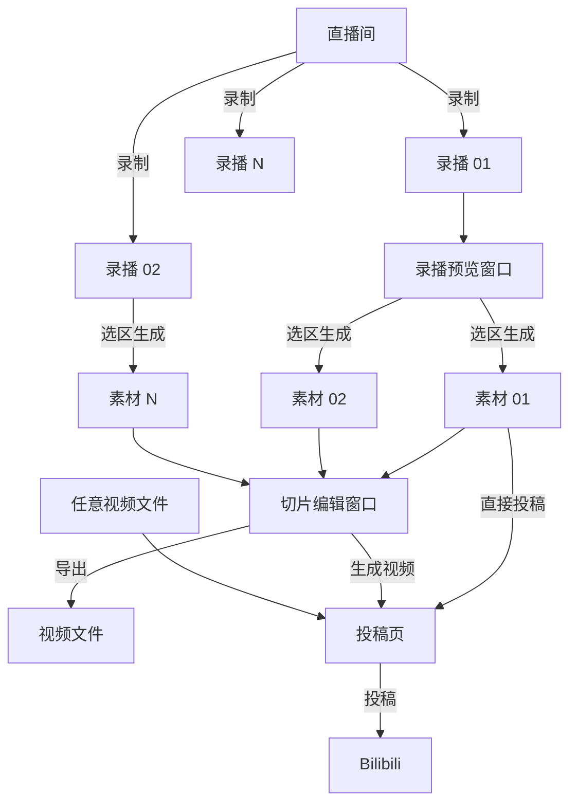

# 工作流程

- 直播间：各个平台的直播间
- 录播：直播流的存档，每次录制会自动生成一场录播记录
- 素材：从录播中截取的一段视频，会同时保存这段时间内的弹幕
- 切片：由一个或多个素材组成的剪辑工程，可裁剪、分割、调整顺序、添加字幕和压制弹幕
- 投稿：选择素材、切片或任意视频文件上传到各个平台（目前仅支持 Bilibili），切片会在投稿时按时间轴生成视频

下图展示了它们之间的关系：

